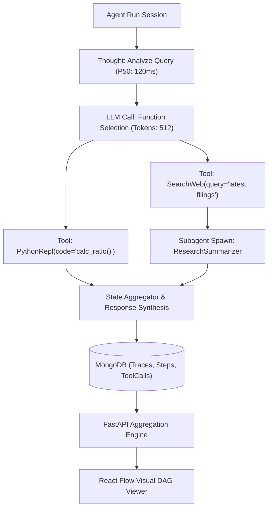

# 🕸️ AgentTrace — AI Agent Observability & Tool Execution DAG

[](https://fastapi.tiangolo.com)
[](https://www.mongodb.com)
[](https://python.org)
[](https://reactflow.dev)
[](https://opensource.org/licenses/MIT)

> **AgentTrace** is a high-performance observability and execution graph visualizer for autonomous AI agents. It models multi-agent workflows, tool calls, reasoning steps, and token economics as an interactive **Directed Acyclic Graph (DAG)** backed by MongoDB's document store.

---

## 🏗️ Architecture & Execution DAG



---

## 🌟 Key Features (4-Day Sprint Roadmap)

- [x] **Day 1: Scaffolding & Architecture**: MongoDB schema design, asynchronous Motor connection lifecycle, Pydantic v2 execution graph models, and configuration.
- [x] **Day 2: Trace Ingestion & DAG Traversal APIs**: Streaming step ingestion endpoints, tool execution logging, DAG topological tree builder with auto-computed coordinates, and trace status management.
- [x] **Day 3: Interactive React Flow DAG Viewer**: Node-based graph canvas, step timeline inspector, token cost break-down, and tool payload drawers.
- [ ] **Day 4: Aggregation Pipelines, Tests & Docker**: MongoDB analytics pipelines (token bottlenecks, error rates, p95 latencies), Pytest integration suites, and Docker Compose environment.

---

## 🚀 Quickstart

### Prerequisites
- Python 3.11+
- MongoDB 6.0+ (local instance or Docker container)

### Setup
```bash
# Clone the repository
git clone https://github.com/haolubo-commits/agent-trace.git
cd agent-trace/backend

# Create virtual environment
python3 -m venv venv
source venv/bin/activate

# Install dependencies
pip install -r requirements.txt

# Run the API server
uvicorn app.main:app --reload --port 8000

# Seed demo execution DAG trace
python seed_demo_trace.py
```

---

## 📑 API Endpoints Reference

### Traces & Graph Hierarchy
- `POST /api/v1/traces/` — Initialize new autonomous agent trace session.
- `GET /api/v1/traces/` — List agent execution traces with pagination and status filters.
- `GET /api/v1/traces/{trace_id}` — Get summary metrics, token totals, and run status.
- `PATCH /api/v1/traces/{trace_id}` — Update trace status, completion time, or metadata.
- `DELETE /api/v1/traces/{trace_id}` — Cascading delete for a trace and all child steps & tools.
- `GET /api/v1/traces/{trace_id}/graph` — Retrieve full React Flow DAG hierarchy (nodes, coordinates, animated edges, tool call payloads).

### Steps & Tool Invocations
- `POST /api/v1/traces/{trace_id}/steps` — Append execution step (thought, llm_call, tool_call, subagent_spawn) to trace DAG.
- `GET /api/v1/traces/{trace_id}/steps` — List all sequential steps in trace.
- `GET /api/v1/traces/step/{step_id}` — Get single step execution details and inputs/outputs.
- `POST /api/v1/traces/{trace_id}/steps/{step_id}/tools` — Record tool invocation logs under a step node.
- `GET /api/v1/traces/{trace_id}/steps/{step_id}/tools` — List tool calls for a step.
- `GET /api/v1/traces/{trace_id}/tools` — List all tool calls for a trace.
